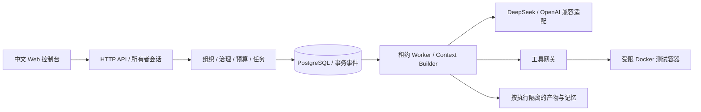

# AI Company OS 产品需求文档

版本：1.1 · 日期：2026-10-29 · 状态：开发前约束完成，等待分阶段实施

修订说明：产品需求保留；当前技术路线已改为 FastAPI + Vue 3 + PostgreSQL + Docker Compose，UI 采用 Element Plus 与 docs/design 规范。本文中的 M0/M1 等产品里程碑与八份开发计划为不同粒度；实际实施顺序以八阶段计划为准。数值与 UI 规范以 design-tokens.json 为准。详见 docs/START-HERE.md 与 ADR-0001。

## 1. 产品定义与成功标准

AI Company OS 是开源、自部署的 AI 虚拟科技公司操作系统。用户以公司所有者身份设置目标、预算和边界；有固定身份的 Agent 按岗位分工、按需唤醒，在组织制度约束下协作，交付真实代码、独立验证证据和可追溯的决策记录。

首批用户为独立开发者及小型研发团队。核心价值是持续推进有边界的研发工作，而非模拟员工聊天、声称达到 AGI 或完全替代人类公司。

**北极星指标：经过授权且通过独立验收、具有可下载产物的任务数量。** 辅助指标：首次交付时间、每次成功交付的 Token 用量、验证失败率、人工介入次数、重启恢复成功率、越权拦截率。没有真实文件、测试日志、执行记录的“完成”不计入交付。

## 2. 已确认决策与实施假设

| 项目 | 已确认产品方向 | 实施处理 |
|---|---|---|
| 部署与开放 | 开源自部署 | 本地优先，具体开源许可证发布前确认；不自动上传代码 |
| 模型 | DeepSeek V4.1 Flash 优先，OpenAI 兼容层 | 默认 API 模型 ID `deepseek-flash`，允许覆盖；服务端持有环境变量密钥 |
| 创建公司 | 公司模板 + 自由编辑 | 模板实例化后独立，模板升级不覆盖公司 |
| 组织 | 混合式管理 | 管理链负责目标与升级；岗位间可通过结构化消息协作 |
| 自主性 | bounded | 在已授权目标、预算、工具范围内行动 |
| 主动性 | Finding → Proposal | 发现不直接变成执行；批准和预算预留成功后才能生成任务 |
| 治理 | delegated | 部门级、CEO 级、人类级；禁止通过升级绕过硬策略 |
| 身份 | 岗位与实例分离 | 公司→部门→版本化岗位→Agent 实例；模型独立绑定 |
| 运行 | 按需唤醒、休眠 | 等待审批时不调用模型；任务、执行、事件持久化 |
| 技能 | 内置核心 + 插件扩展倾向，尚未最终确认 | 本轮仅内置受限代码产出/隔离测试/归档工具；预留接口，不实现插件市场 |

实施假设：第一轮交付为 **M0 可运行纵向切片**，先支持单所有者、单公司、多个项目、Python 标准库代码任务。完整博客网站、任意仓库改造、多语言构建和生产部署属于后续 MVP 里程碑。这是一项工程收敛，不改变完整产品构想。确定性离线演练与真实模型模式必须显式区分，演练不得冒充模型自主推理。

来源范围：读取引用会话当前可返回的 5 个回合（bounded、proposal、delegated、template、切换工作模式），与本次明确列出的决策合并。更早 AGI 讨论未作为额外事实推断。

## 3. 用户角色与端到端旅程

所有者：设置预算、模型连接和章程；创建项目目标；审查高风险提案；暂停公司；下载并检查交付。

CEO：拆解目标、协调部门、处理资源冲突和优先级，不拥有绕过测试或访问密钥的特权。

产品经理：明确范围、输入输出契约与验收标准；对产品范围有建议/决策权。

技术负责人/开发：实现代码，提交可验证文件；不能自己批准自己的新增工作。

QA：独立验收，记录缺陷、创建 Finding，质量门禁失败可阻断交付。

DevOps：生成交付清单与运行说明；生产部署必须走人类授权，M0 不提供部署执行器。

主旅程：启动服务 → 查看默认科技公司 → 编辑实例/职责/模型 → 配置并测试模型连接 → 输入项目目标 → CEO/PM 明确方案与验收 → 开发产出代码 → 隔离测试 → QA 复核 → DevOps 归档 → 下载源码、测试和证据。发现问题时生成 Finding/Proposal → 决策路由 → 审批/拒绝/升级 → 原子预留预算并排队 → 新执行 → 证据进入项目记忆。

异常旅程：预算不足不得启动；测试失败不得标记成功；Docker 不可用不得退回宿主机运行；模型超时留下执行记录；服务重启后排队任务保留，已运行任务进入待人工确认的中断状态；暂停后禁止开始新模型调用。

## 4. 功能需求与优先级

| ID | 优先级 | 需求 | 验收条件 |
|---|---|---|---|
| ORG-01 | P0 | 默认模板生成 5 岗位及 5 实例 | ID 独立，编辑实例不改变岗位模板，切换模型保留履历 |
| ORG-02 | P0 | 组织可视化与编辑 | 展示部门、岗位、汇报线、实例状态；编辑名称、职责、模型与主管；拒绝环形管理关系 |
| ORG-03 | P1 | 招聘、调岗、离职与临时员工 | 入职测试、撤权、任务交接、保留历史；新增权限必须审核 |
| MOD-01 | P0 | 模型中心 | Provider/Model/Assignment 分层展示；编辑 base URL、模型 ID、密钥环境变量名；测试 JSON 输出并记录结果；不返回密钥 |
| MOD-02 | P1 | 能力与故障策略 | 记录结构化输出、工具、上下文等实测能力；有限重试；备用模型不得静默扩大成本或权限 |
| TASK-01 | P0 | 目标、项目、任务、执行分离 | 每次重试独立执行 ID；旧产物和验证证据不可覆盖 |
| TASK-02 | P0 | 可恢复持久队列 | 事务领取、单次领取、租约与心跳；重启保留记录；重复请求不重复建任务 |
| TASK-03 | P1 | 任务依赖图与并行 | 拒绝环、依赖未完成时阻塞；依赖版本变化触发复验 |
| RUN-01 | P0 | 受限代码工作单元 | 接收目标，生成 `solution.py`、独立验收测试、README；执行后归档哈希和日志 |
| RUN-02 | P1 | 任意 Git 项目实施 | 专用开发分支/工作区、补丁、差异审查、构建与回归测试，不直接合并主分支 |
| GOV-01 | P0 | Finding 与 Proposal 分离 | Finding 包含来源证据；Proposal 包含目标、成本、风险、验收条件；项目内指纹去重 |
| GOV-02 | P0 | 分级授权路由 | 低风险技术范围路由技术岗位；跨部门路由 CEO；范围扩大、预算变更、高风险路由所有者；不允许自批 |
| GOV-03 | P0 | 审批原子性 | 决策、任务、预算预留、事件同一事务；重复批准仅返回原任务 |
| GOV-04 | P1 | 升级与跨部门冲突 | 最多两轮补充/协商，超时升级；QA 失败不可由 CEO 单独绕过；记录意见、证据、责任人 |
| SEC-01 | P0 | 工具网关和任务作用域 | 平台策略∩岗位能力∩项目授权∩任务授权；管理线变化不扩大权限；外部内容不能授予能力 |
| SEC-02 | P0 | 隔离执行 | 代码不在控制平面执行；无网络、非 root、只读文件系统、CPU/内存/PID/时间限制、无宿主凭据挂载 |
| SEC-03 | P0 | 人类高风险授权 | 高风险状态等待所有者；批准只记录决策，不安装尚未实现的执行能力 |
| SEC-04 | P0 | 熔断、暂停与审计 | 禁止超预算新调用；全公司暂停；每个状态变化有操作者、对象、时间、原因和关联 ID |
| BUD-01 | P0 | 公司/项目/任务三级额度 | PostgreSQL 事务原子预留；本轮以 Token 为硬限制单位，费用仅后续可配置估算 |
| BUD-02 | P1 | 价格与结算 | 价格版本、输入/输出/缓存计量、实际费用与估算分离；无用量或调用结果不明时保守计费 |
| CTX-01 | P0 | 上下文隔离 | 只包含当前岗位、任务、项目及已验证的本项目记忆；不把密钥、其他项目消息送模型 |
| MEM-01 | P0 | 记忆和证据持久化 | 工作记忆=阶段记录；任务记忆=产物/执行；项目记忆=验证摘要；带来源和版本 |
| MEM-02 | P1 | 组织记忆晋升 | 候选→审查→生效/过期；项目经验不得直接成为全公司政策 |
| MSG-01 | P0 | 结构化消息和事件总线 | 消息含 sender/receiver/type/task/correlation/payload；事务事件按序追加并可重放读取 |
| WEB-01 | P0 | 中文 Web 控制台 | 公司概览、模型中心、组织编辑器、项目任务看板、提案中心、审计和产物下载 |
| OBS-01 | P1 | 指标与导出 | 按任务/实例/项目统计调用、用量、错误；可导出审计与备份 |

## 5. 组织、授权与生命周期

默认部门：管理、产品、研发、质量、运维。技术负责人兼任开发，因此首版是五岗位，不将“技术负责人”和“开发”误拆为第六岗。

岗位版本记录职责、交付标准、基础能力、审批领域；Agent 记录身份、名称、所属岗位、模型绑定和员工状态。一次 Execution 固化当时岗位版本、实例资料和模型 ID，避免调岗改写历史。员工状态为 ACTIVE/PAUSED/ARCHIVED；运行状态由执行记录推导为 SLEEPING/WORKING/WAITING。

公司章程独立于 Prompt，版本化保存。有效权限为岗位、项目、任务、公司硬策略的交集；主管关系只决定汇报路线。后续权限租约必须含资源、动作、有效期、次数和不可再委托标记。M0 不提供动态权限扩张和二次委托，内置角色能力固定。

## 6. 提案决策与质量制度

Finding：事实、证据、严重程度、范围、指纹、来源执行。Proposal：关联 Finding、方案、收益、验收、风险、预算、状态、审批层级。Decision：操作者、理由、政策版本、批准范围、时间。高风险示例为生产操作、外部发送、付费购买、删除资产、访问秘密。

路由顺序：硬策略禁止→直接拒绝；高风险/超范围→所有者；跨部门→CEO；领域内且额度足够→非申请人的部门负责人；主管缺位/自批冲突→CEO 或所有者。M0 低风险系统预授权策略可作出可审计的部门级批准，不声称这是模型独立审批；人工也可操作路由内的决策。

状态：PENDING → APPROVED / REJECTED / ESCALATED；批准产生任务；硬策略禁止的工具不因 APPROVED 变可用。M0 高风险批准只留档，任务 BLOCKED，避免虚构生产执行能力。

质量门禁按顺序：产物结构有效 → 文件白名单/大小 → 验收测试可发现且至少 1 项 → 隔离测试退出码为 0 → QA 结构化评审通过 → 哈希清单。PM 先生成验收测试，开发只写代码，不能改验收测试。模型评审不得覆盖测试失败。失败自动生成 Finding 及待审修复 Proposal，不自动无限重试。M0 每任务最多 3 次执行，重试须显式操作。

## 7. 持久任务、事件与恢复

目标产品状态机：DRAFT→READY→QUEUED→RUNNING→VERIFYING→SUCCEEDED；旁路含 WAITING_INPUT、WAITING_APPROVAL、BLOCKED、FAILED、CANCELLED、INTERRUPTED。M0 实现 QUEUED/RUNNING/VERIFYING/SUCCEEDED/FAILED/BLOCKED/CANCELLED/INTERRUPTED；审批等待保存在 Proposal，输入不足作为失败/阻塞处理，后续补充完整交互。

Execution 阶段：CEO 计划 → PM 验收 → DEV 实施 → QA 验证/评审 → DEVOPS 归档。每个阶段保存结构化消息、模型用量与产物。任务表示责任和目标，Execution 表示一次尝试；二者不得混用。

创建任务与额度预留写入同一事务。Worker 从数据库领取排队任务，续租，启动下一调用前检查暂停、租约、预算、员工可用性。DB 事件表充当事务事件日志与可轮询总线；消费者使用递增 seq 读取，外部消费者自行保存游标；未来扩展 outbox 分发和死信，不宣称当前有分布式恰好一次保证。

M0 对崩溃中的执行采取保守恢复：租约过期后标记 INTERRUPTED，不自动重放未知是否已收费的模型请求或外部操作，保留本次完整预算为保守消耗；所有者可以启动新尝试。排队任务正常恢复。预留预算不会因为进程崩溃被误释放。

## 8. 数据模型与接口

核心表：settings/company、positions、agents、projects、tasks、executions、findings、proposals、decisions、events、messages、memories。关系：Project 1:N Task；Task 1:N Execution；Finding 1:N Proposal；Proposal 0:1 授权 Task；Execution 1:N Message/Artifact。事件 seq 为单调序列；记录 ID 使用随机不可预测值；时间使用 UTC，界面本地化。

主要接口（M0）：

| 方法与路径 | 行为 |
|---|---|
| GET /api/v1/state | 脱敏公司、组织、项目、任务、提案、审计和记忆 |
| POST /api/v1/projects | 创建项目目标并创建首次执行，要求幂等键 |
| POST /api/v1/models | 保存连接及环境变量名 |
| POST /api/v1/models/test | 有限调用验证 JSON 输出，演练模式明确标识 |
| POST /api/v1/agents/{id} | 修改实例，校验主管环，不允许修改固定工具能力 |
| POST /api/v1/proposals/{id}/decision | 所有者批准/拒绝，事务化操作 |
| POST /api/v1/tasks/{id}/retry | 新 Execution，不覆盖旧证据 |
| POST /api/v1/company/pause | 暂停/恢复 |
| GET /api/v1/events?after=seq | 事件增量读取 |
| GET /api/v1/executions/{id}/artifact | 下载该次执行的源码、测试和证据 ZIP |

Web 控制台通过单所有者认证和服务端会话访问同源 API，默认本机入口，内部数据库与执行器不对外暴露。阶段 01 实现会话及写请求保护；远程部署配置 TLS 与入口访问策略。

## 9. 技术架构与工程决策

当前实施：FastAPI + Pydantic + SQLAlchemy 2 + Alembic，PostgreSQL，Vue 3 + TypeScript + Vite + Router + Pinia + Element Plus。通过 Docker Compose 部署 Web、API、Worker、数据库和执行器，迁移独立运行；模块化单体、独立 Worker，版本在阶段 01 验证并锁定。UI 颜色、尺寸、组件和页面遵守 docs/design。首版无需引入 Redis、向量库或微服务。仅专用执行器可按受限方案管理任务容器，普通 Agent、API、Worker 与任务容器不获得宿主 Docker Socket。

模型适配：POST `{base_url}/chat/completions`，结构化 JSON 输出，由本地严格校验。Provider 请求不带工具执行权限，模型仅返回受限数据；平台执行固定工具。每次调用有输出 Token 上限、超时、输入大小与总额度控制。M0 不自动重试或静默降级。OpenAI 兼容表示协议适配，不等于已在所有供应商上验证。

记忆：关系数据库存摘要及来源、文件存证据；仅检索本项目的已验证条目，限数量及长度；不采用无限共享聊天上下文。全文/向量检索、知识过期和组织晋升在 M2 实现。

## 10. 预算与安全边界

M0 采用 Token 配额，明确展示 reserved/spent/limit。每次执行预留 32,000 Token；每个模型调用以输入 UTF-8 字节数保守估算加最大输出量校验剩余额度；有用量则记账，无用量/异常则保守记账。公司和项目额度必须同时满足，任务额度等于本次预留上限。探测调用也须预留公司预算。供应商自身计费与延迟结算可能不同，软件配额不能替代供应商账户限额。

隔离容器：固定 Python 镜像，禁止拉取未知镜像；无网络、只读根、丢弃 capabilities、no-new-privileges、非 root、PID/内存/CPU 限制、仅只读挂载本次源代码与独立验收、临时 /tmp、超时强制删除容器。禁用宿主 shell、任意命令、动态包安装、仓库外文件读取、外部发布、生产部署、秘密注入。测试文件本身也是不可信代码，必须放在同一隔离器中执行。

Docker 容器共享内核，不能宣称抵御所有恶意代码；M0 面向可信所有者在专用开发机使用。未来面向敌对多租户须采用专用 VM/microVM 或更强执行服务。数据库审计是应用级只追加，不提供防宿主管理员篡改保证。

密钥只来自服务环境变量，接口只显示“已配置/未配置”；不写入 JSON、数据库、Prompt、产物和 ZIP。不加载任意 `.env`，不读取用户其他应用的凭据。自定义 base URL 由所有者配置，禁止 URL 内嵌凭据/查询参数，默认 HTTPS；本机 HTTP 兼容服务可用。生成模型内容不得出现在 UI 的未转义 HTML 中。

## 11. 里程碑与退出条件

| 里程碑 | 内容 | 退出条件 |
|---|---|---|
| M0 本轮 | PRD、工程、模板、控制台、离线/真实适配、代码生成验证、提案/预算/审计 | 离线演练通过真实 Docker 测试；API 测试验证拒批/去重/预算/重启；明确真实 API 尚未验证的边界 |
| M1 真实模型闭环 | 供应商实测、任意小型 Python 项目、有限返工、独立 QA | 配置用户密钥后连续 3 个真实目标交付并通过人工抽查；成本可追溯，失败可恢复 |
| M2 完整研发 MVP | Git 项目、任务 DAG、Worker 扩展、完整审批升级、组织生命周期 | 从博客项目目标交付可启动代码；故障注入后无重复业务操作；跨项目隔离测试通过 |
| M3 自部署发布 | Web 认证、部署打包、备份恢复、文档与安全审查 | 新环境按文档安装成功；恢复演练通过；公开仓库由所有者决定发布 |
| 后续 | 插件/MCP、自动招聘、多语言、授权巡检、组织记忆晋升 | 必须先确认扩展协议和插件信任模型 |

不承诺未经验证的日历工期。建议 M0 评审后按验收条件迭代，而非按 Agent 数量扩大功能。

## 12. 测试与验收用例

AC-01：新安装看到五个岗位；编辑 Agent 名称/模型不会删除身份或历史。

AC-02：离线标准库任务产出可下载源码/验收/日志；Docker 内运行至少一项真实测试且退出码为零；界面明确“离线演练”。

AC-03：真实模型在缺少环境变量密钥时给出明确错误，不能静默切换演练；存在密钥时走兼容 API，保留模型和用量证据。

AC-04：同一幂等键重复创建只生成一个项目；同一提案重复批准只生成一个任务；并发预算预留不超额度。

AC-05：审批前没有新增执行；拒绝后没有新增执行；高风险批准仍不能启动未支持的工具。

AC-06：开发代码不能改 PM 验收文件；零测试、失败测试、超时、Docker 缺失均不得成功。

AC-07：公司暂停后不开始新模型调用；过期租约成为中断，排队任务重启后继续；手动重试保留原执行证据。

AC-08：接口无密钥明文、无权限身份伪装；目录穿越/额外产物路径被拒；非同源或缺少会话令牌的写请求失败。

AC-09：任务失败自动生成带执行来源的 Finding 和 Proposal；批准后新任务有预算预留；成功后产生带来源的项目记忆。

AC-10：任何 SUCCEEDED 执行对应测试证据、QA 决策和 SHA-256 清单；仅模型声称成功不能通过验收。

## 13. 开放项与风险

技能扩展尚未定案；不提前引入任意第三方代码执行。多模型可能共享偏见；以独立测试和人工抽查补强。PM 生成测试可能不完整；测试通过只是验收证据，不是功能正确性的绝对证明。M0 的审批规则和五岗位阶段编排属于受约束协作的工程起点，不等于已实现长期自主经营。公开托管、生产部署、外部消息、消费支付均不在本轮执行范围。

## 14. 外部技术依据

核对日期 2026-10-29。官方 [DeepSeek 首次调用文档](https://api-docs.deepseek.com/) 当前使用 `deepseek-flash` 访问 V4.1 Flash；[Chat Completions 接口](https://api-docs.deepseek.com/api/create-chat-completion/) 用于适配。模型名称/能力可能变化，运行时允许覆盖并实际探测。定价不在本 PRD 固化，避免陈旧价格驱动错误预算。
